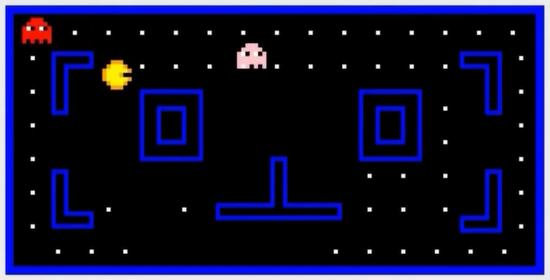
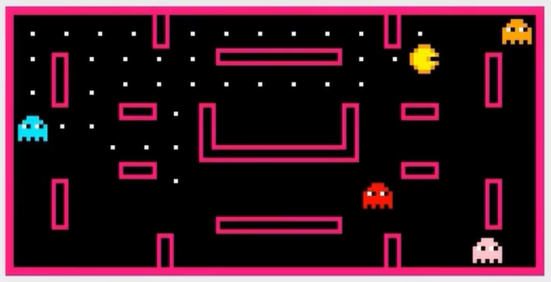
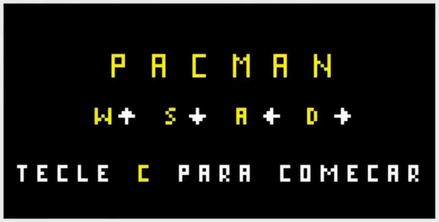
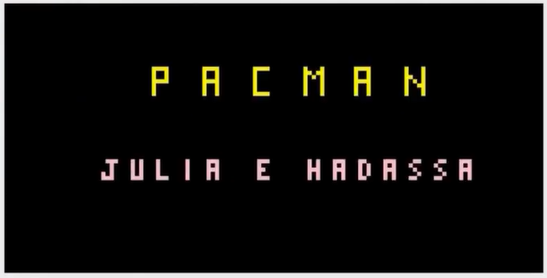

# Pac-Man em Assembly MIPS

Este é um clone clássico do jogo **Pac-Man desenvolvido inteiramente em Assembly MIPS** executado no simulador **MARS**, focado no controle de hardware bit a bit, manipulação de memória e física de baixo nível.

---

## Contexto Acadêmico

O projeto foi desenvolvido para a disciplina de **Arquitetura de Computadores** como parte das avaliações da 2º etapa do 2º semestre e apresentado no evento **WTADS**. Seu objetivo foi aplicar na prática conceitos como registradores, pilha, memória, chamadas de sub-rotinas, instruções em baixo nível e organização da representação gráfica em Assembly MIPS.

## Demonstração Visual

---

## Desafios Técnicos e Soluções Arquiteturais

*   **Renderização no Bitmap Display:** A tela foi configurada na resolução de **128x64 pixels** (8.192 pixels no total). Cada linha consome **512 bytes** de memória (`128 pixels * 4 bytes/pixel`). A lógica gráfica foi calculada manualmente: somando `+4` para o próximo pixel horizontal e `+512` para pular para a próxima linha vertical.
*   **Interface por Matriz de Fonte (5x5):** As telas de início (títulos e nomes em amarelo e rosa), instruções e telas de *Win/Game Over* foram geradas programaticamente mapeando matrizes binárias de caracteres (ex: `font_A`, `font_S`, `font_J`) direto na memória de vídeo.
*   **Sistema de Colisão por Espelhamento Oculto:** Para evitar que os personagens apagassem ou deixassem rastros pretos nas paredes do cenário ao se movimentarem, foi criada uma **cópia oculta do mapa na memória**. Os fantasmas e o Pac-Man consultam essa matriz oculta para calcular a física de colisão dupla sem corromper o visual do jogo.
*   **Gerenciamento Estrito de Registradores e Pilha:** Para economizar registradores voláteis, centralizamos a paleta de cores (hexadecimais), offsets e o vetor dinâmico de pastilhas na diretiva `.data`. O uso da pilha (`stack`) foi mandatório para blindar e preservar os endereços de retorno (`$31` / `jal`) das sub-rotinas de movimento e desenho.

---

## Limitações da Implementação

Como esta é uma recriação acadêmica com foco na prática de baixo nível, algumas funcionalidades da versão original não foram implementadas: poder temporário para comer fantasmas, sistema de vidas e frutas especiais.

---

## Dinâmica do Jogo e Controles

*   **Fase 1 (Modo Fácil):** O mapa inicial possui migalhas mapeadas por um vetor dinâmico decrementável e apenas 2 fantasmas perseguidores ativos.

*   **Fase 2 (Modo Difícil):** Ao comer todas as migalhas, o contador é reciclado. O labirinto muda de cor (transição entre tons de rosa e azul), o mapa recebe o dobro de NPCs (4 fantasmas no total: Blinky, Pinky, Inky e Clyde) com movimentação automática baseada em loops de tempo independentes.

*   **Mecânica de Game Over:** Colidir com qualquer fantasma aciona a tela de fim de jogo nas duas fases, reiniciando o progresso do nível atual.

### Controles (Keyboard MMIO)
*   `W`: Move para Cima
*   `A`: Move para a Esquerda
*   `S`: Move para Baixo *(Também funciona para iniciar o jogo na tela de Menu)*
*   `D`: Move para a Direita
*   `C`: Tecla de confirmação para iniciar as fases após as instruções/telas de transição.

---

## Como Executar o Projeto

### Configuração Obrigatória do MARS
Abra a ferramenta **Bitmap Display** no MARS e configure exatamente os parâmetros abaixo:
*   **Unit Width/Height in Pixels:** 1
*   **Display Width in Pixels:** 128
*   **Display Height in Pixels:** 64
*   **Base Address for Display:** `0x10010000 (.data)`

Para capturar os movimentos, abra e conecte a ferramenta **Keyboard and Display MMIO Simulator**.

### Passo a Passo
1. Certifique-se de ter o Java JDK instalado na sua máquina e baixe o simulador MARS.
2. Baixe o código fonte deste repositório (`.asm`).
3. Abra o arquivo no MARS e aperte `F3` (Assemble).
4. Abra as duas ferramentas descritas na seção acima e clique em **Connect to MIPS**.
5. Aperte `F5` (Run) e clique na caixa de texto do simulador de teclado para jogar.

---

## Desenvolvedoras

*   **Hadassa Medeiros**
*   **Júlia Vitória**